  

# 🎯 Awesome Goal Management 🚀

  
  
  
  
  

> ⚡ **A curated directory of enterprise SaaS platforms and open-source GitHub projects for Goal Management, Objectives & Key Results (OKRs), Continuous Performance Tracking, Strategy Execution, and Cascading Alignment.**

---

## 📑 Table of Contents

- [📊 Sector Overview & Market Dynamics](#-sector-overview--market-dynamics)
- [🏢 SaaS & Commercial Platforms](#-saas--commercial-platforms)
- [💻 Open-Source GitHub Projects](#-open-source-github-projects)
- [🤝 How to Contribute](#-how-to-contribute)
- [💖 Support & Sponsorship](#-support--sponsorship)
- [📈 Star History](#-star-history)
- [⚠️ Disclaimer](#%EF%B8%8F-disclaimer)

---

## 📊 Sector Overview & Market Dynamics

> 💡 **Market Size & Structure**: The global Performance and Goal Management Software market is valued at approximately **$5.03 Billion in 2026** and is projected to expand at a compound annual growth rate (**CAGR) of 17.1%**, surpassing **$20 Billion by 2035**.  
> The sector is **moderately fragmented**—anchored by diversified enterprise HCM giants (such as Workday) at the top end, while highly competitive mid-market specialized Work OS and agile OKR suites (such as Lattice, Culture Amp, and 15Five) capture dynamic growth through continuous check-ins and AI-assisted alignment.

---

## 🏢 SaaS & Commercial Platforms

The following SaaS goal and performance management platforms are sorted in descending order by company scale (market capitalization or valuation):

| Platform | Market Scale (Valuation / Market Cap) | Focus & Key Capabilities | Starting Pricing | Free Tier / Free Trial Limits |
| :--- | :--- | :--- | :--- | :--- |
| **[Workday Goal Management](https://www.workday.com/)** | **~$52 Billion** Market Cap (NASDAQ: WDAY) | Enterprise HCM-integrated goal tracking, strategic workforce cascading, performance reviews, and talent development. | **$34 to $45/employee/month** (Core HCM base; full multi-module deployments typically $90–$150 PEPM) | **No self-service free trial** (enterprise guided POC and sales demo upon qualification) |
| **[Lattice](https://lattice.com/)** | **$3.0 Billion** Valuation (Series F) | People management platform integrating OKRs and SMART goals with weekly check-ins, continuous feedback, reviews, and compensation. | **$8/user/month** (Standalone OKRs/Goals; Foundations bundle at $13/user/month; $4,000/year platform minimum) | **No free tier**; no self-serve free trial (custom live guided product demo upon request) |
| **[Culture Amp](https://www.cultureamp.com/)** | **$1.5 Billion** Valuation (Series F) | Employee experience platform uniting continuous goal alignment with engagement diagnostics, performance reviews, and 1-on-1s. | **~$11/user/month** (Starting packages typically scale from ~$4,500/year minimum contract value) | **No free tier**; no public self-serve free trial (scheduled product demo with account team) |
| **[WorkBoard](https://www.workboard.com/)** | **$800 Million** Valuation (Series D) | Enterprise strategy execution and OKR platform offering outcome visualization, automated business reviews, and meeting telemetry. | **$20/user/month** (Team/Core tier; Enterprise strategy execution tier at $50/user/month) | **No free tier**; no free trial (enterprise consultation and live sales demo) |
| **[Leapsome](https://www.leapsome.com/)** | **$300 Million** Valuation (Series A) | All-in-one people enablement suite uniting goal/OKR tracking with continuous feedback, engagement surveys, learning, and reviews. | **$7/user/month** (Base platform module starting tier; team base fee from $199/month) | **14-day free trial** with full feature access (no credit card required) |
| **[Quantive (Gtmhub)](https://quantive.com/)** | **$160M+ Raised** (Acquired by WorkBoard) | Strategic execution and OKR system with 160+ automated business data connectors, visual KPI whiteboards, and progress tracking. | **$9/user/month** (Team tier; Business and Enterprise tiers quoted per organization scope) | **30-day free trial** with core OKR workflows and dashboard templates |
| **[Betterworks](https://www.betterworks.com/)** | **$130M+ Raised** (Enterprise Scale) | Enterprise-grade OKR alignment engine linking daily employee execution to top-level organizational objectives with check-ins. | **$8/user/month** (Base Performance & Goals tier; $9/user/month for Performance + Talent Intelligence) | **No free tier**; 7-day guided enterprise trial available upon sales qualification |
| **[15Five](https://www.15five.com/)** | **~$100M+ ARR Scale** (Venture Backed) | Human-centered performance platform combining OKR tracking with weekly check-ins, 1-on-1 agendas, and manager coaching tools. | **$4/user/month** (Engage plan; Perform & OKRs bundle starts at $11/user/month, billed annually) | **14-day free trial** with full access to check-ins, OKRs, and feedback modules |
| **[Profit.co](https://www.profit.co/)** | **$11M+ Raised** (Fast Growing) | Comprehensive OKR management platform featuring 360-degree reviews, strategy maps, alignment scoring, and pre-built OKR libraries. | **$9/user/month** (Growth plan, billed annually) | **30-day free trial** on paid plans (limited free tier restricted to 1 user only) |
| **[Weekdone](https://weekdone.com/)** | **$1.5M ARR Scale** (Bootstrapped/Seed) | Focused OKR and weekly status planning (PPP: Plans, Progress, Problems) tool for small-to-mid teams with automated reminders. | **$9/user/month** (Packages starting from $90/month for up to 10 users, billed annually) | **Free Forever plan for up to 3 users** (includes all core features; 14-day free trial for larger teams) |

---

## 💻 Open-Source GitHub Projects

The following open-source goal and OKR management repositories are sorted in descending order by **GitHub Star Count** 🌟. Click any badge to view its stargazers:

- 🌟 **[OpenProject](https://github.com/opf/openproject)**   
  General-purpose enterprise project and goal management platform (GPL-3.0) with configurable work package types for **Objectives & Key Results (OKRs)**, hierarchical parent-child cascading, progress tracking via percent-complete metrics, and team version roadmaps.

- 🌟 **[Awesome OKR](https://github.com/domenicosolazzo/awesome-okr)**   
  Curated collection of resources, articles, case studies, and templates for understanding and adopting the Objective and Key Results methodology across teams.

- 🌟 **[vue-okr-tree](https://github.com/husky-dot/vue-okr-tree)**   
  Vue.js component designed specifically for rendering tree-structured OKR cascades, organizational alignment maps, and progress distributions across business units.

- 🌟 **[Operately](https://github.com/operately/operately)**   
  Open-source company operating system (Apache-2.0) purpose-built for **Goals and OKRs** linked directly to operational initiatives; features milestone check-ins, automated status updates, team spaces, and self-hosting via Docker in minutes.

- 🌟 **[Objectives and Key Results Examples](https://github.com/joelparkerhenderson/objectives-and-key-results)**   
  Comprehensive repository of real-world OKR templates, metrics, and measurable key result examples for software engineering, product management, and business operations.

- 🌟 **[bamboobsc](https://github.com/billchen198318/bamboobsc)**   
  Enterprise Balanced Scorecard (BSC) and strategic KPI goal platform written in Java, facilitating organizational scorecard design, weight calculations, and target achievement analysis.

- 🌟 **[Obsidian OKRs](https://github.com/nicolevanderhoeven/obsidian-okrs)**   
  Modular templates and workflow system for setting, reviewing, and tracking quarterly personal and organizational OKRs within Obsidian notes.

- 🌟 **[Thrive](https://github.com/get-thriving/thrive)**   
  Open-source organizational goals and growth management application enabling structured objective definition, milestone checkpoints, and transparent team accountability.

- 🌟 **[BurningOKR](https://github.com/BurningOKR/BurningOKR)**   
  Dedicated open-source OKR management system built with Angular and Spring Boot, offering structured goal cascading, quarterly review cycles, and visual company hierarchies.

- 🌟 **[okr-tracker](https://github.com/oslokommune/okr-tracker)**   
  Clean Vue and Firebase application created by the Municipality of Oslo for tracking product team OKRs and Key Performance Indicators (KPIs) in real time.

- 🌟 **[JVS Teamwork](https://github.com/RKQF-JVS/jvs-teamwork)**   
  Collaborative team platform combining agile task boards, personal to-do workflows, and organizational OKR target tracking.

- 🌟 **[Strapi OKR API](https://github.com/seanrioux/strapi-okr-api)**   
  Headless, API-first CMS plugin built on Strapi providing data structures and RESTful endpoints for custom OKR apps and dashboards.

- 🌟 **[hillfog](https://github.com/billchen198318/hillfog)**   
  Multi-framework performance and target management web platform supporting OKRs, KPIs, Balanced Scorecard (BSC), and PDCA cycles.

- 🌟 **[okr2go](https://github.com/oxisto/okr2go)**   
  Lightweight command-line OKR tracker written in Go that manages personal and team objectives using clean, human-readable Markdown files.

- 🌟 **[Pilot OKR](https://github.com/GrailStack/Pilot)**   
  Full-stack enterprise OKR management architecture modeled after high-scale internal goal tracking tools, featuring alignment cascades and team scoring.

- 🌟 **[OKR System](https://github.com/zhouwenjun-hub/okr)**   
  Full-featured OKR tracking application built with Vue 2, Spring Boot 3, and MySQL, featuring hierarchical goal alignment trees and execution completion analytics.

---

## 🤝 How to Contribute

Contributions are warmly welcomed! Help make this ecosystem repository the definitive guide for HR practitioners, strategy leaders, and software engineers:

1. 🍴 **Fork** this repository.
2. 🌿 **Create a new branch**: `git checkout -b feat/add-goal-management-tool`
3. ✏️ **Add your entry** following the tabular or bulleted format with accurate links, starting pricing, and verified limits.
4. 🚀 **Commit & Push**: `git commit -m "Add [Tool Name] to goal management directory"`
5. 📬 **Submit a Pull Request** with a concise description of why the tool is relevant.

---

## 💖 Support & Sponsorship

Thank you for exploring and using this repository! If you find this curated list helpful for your organizational strategy, OKR rollout, or engineering projects, please consider supporting the project:

- ⭐ **Star this repository** on GitHub to show your appreciation and help others discover it.
- 🔀 **Fork & Share** it with your colleagues, leadership teams, and developer community.
- ☕ **Buy me a coffee / Sponsor**: You can sponsor ongoing maintenance and open-source updates via the [GitHub Sponsor Dashboard](https://github.com/sponsors/ishandutta2007).

---

##  Star History

---

## ⚠️ Disclaimer

- This is a **community-curated list** provided for informational, strategic planning, and educational purposes only; inclusion does not constitute commercial endorsement.
- Goal and performance management platforms handling employee review data, compensation records, and internal KPIs must comply with applicable privacy laws (e.g., GDPR, CCPA/CPRA) and internal access controls.
- Open-source tools provide excellent foundations for customized internal workflows; verify licensing terms (Apache-2.0, GPL-3.0, MIT) before production and commercial deployments.
